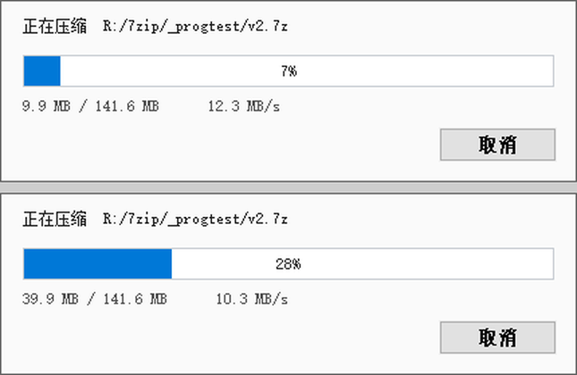

# 7zPack

把 7-Zip 的压缩 / 解压能力封装成 **DLL**，供 AHK 使用。

支持官方 7-Zip 与 [7-Zip-zstd](https://github.com/mcmilk/7-Zip-zstd) 分支，所以能用上 ZSTD / Brotli / LZ4 这些新算法。

## 什么是 ZSTD

ZSTD 是一种新的压缩算法，相同压缩率下，速度远超其它；相同速度下，压缩率又是最高的。

所以强烈推荐使用此算法进行文件压缩。

## 示例

```ahk
; 压缩：源 → 归档
7zPack.Pack("C:\Users\me\Documents", "D:\bak\docs.7z")

; 解压：归档 → 目录
7zPack.Unpack("D:\bak\docs.zip", "D:\restore")

; 失败时取说明
if (!7zPack.Pack("C:\Users\me\Documents", "D:\bak\docs.7z"))
    MsgBox % 7zPack.ErrText()

; 加载库
#Include 7zPack.ahk
```

## 特性

|    |                                                                             |
| -- | --------------------------------------------------------------------------- |
| 压缩 | **扩展名只能用** `.7z` （LZMA2 / ZSTD / Brotli / LZ4 / LZ5 / Lizard / Copy 七种算法可选） |
| 解压 | 支持 `7z.dll` 里注册的全部格式（7z/zip/rar/tar/gz/xz/iso…），按扩展名 + 文件头自动识别              |
| 参数 | 压缩级别 0–9、线程数、固实开关、`zstd --max`                                              |
| 加密 | 支持密码（压缩与解压）                                                                 |
| 进度 | 可选的内建进度窗口，可取消                                                               |
| 安全 | 先写 `.tmp` 再原子替换，中途失败不会破坏旧归档                                                 |
| 依赖 | 只需 `7z.dll`，运行时动态加载，换版本不用重编译                                                |

## 目录

```
7zPack/
├── 7zPack.dll          编译好的 x64 DLL
├── 7z.dll              默认提供 zstd 分支版本（可用速度最快的 ZSTD 算法压缩），也可以自行使用官方 7-Zip 版本替换
├── 7zPack.ahk          AHK v1 库
├── demo.ahk            简单示例，双击即可运行
├── test.ahk            完整自检（压缩/解压/校验/加密/错误分支）
├── progress.png
└── src/
    ├── 7zapi.cpp       封装层源码
    ├── client7z.patch  对 7-Zip 示例代码的改动
    └── build.sh        一键构建
```

## 常用组合

```ahk
; ZSTD 级别3 自动线程数 固实（此级别压缩与解压速度巨快）
7zPack.Pack(src, arc)

; ZSTD 级别5 自动线程数 固实 加密 带进度条
7zPack.Pack(src, arc, 1, 5, 0, 1, 0, "密码", 1)
7zPack.Unpack(arc, out, "密码", 1)
```

## 进度窗口

AHK 是单线程，`DllCall` 期间脚本卡住，`SetTimer` 不跑、`Gui` 不重绘，所以进度条**不能在 AHK 侧画**。

也不能用 `RegisterCallback` 接 7-Zip 的进度回调——那些回调来自多个线程，跨线程调 AHK 会崩。

所以窗口、消息泵、刷新全部由 DLL 负责：

```ahk
7zPack.Pack(src, arc, 1, 9, 0, 1, 0, "", 1)   ; 最后一位 = 显示进度
7zPack.Unpack(arc, out, "", 1)
```

- 窗口跑在**独立 UI 线程**，用自己的消息队列，不碰宿主进程的消息队列。
- 带 `WS_EX_NOACTIVATE`，只显示不抢焦点，正在打字或看视频都不会被打断。
- **350 ms 阈值**：小任务不弹窗，避免一闪而过。
- 点「取消」→ 返回 `false`、`ErrCode()` 为 `11`，`.tmp` 立即删除，不会留下半截归档。



## 7z.dll 版本兼容性

本 DLL 只用 `7z.dll` 的 3 个扁平导出（`CreateObject` / `GetNumberOfFormats` / `GetHandlerProperty2`），其余全靠 COM 接口，所以**换 7z.dll 不需要重新编译**。实测 8 个版本：

| 7z.dll                                   | 压缩 LZMA2 | 压缩 ZSTD | 压缩 Brotli | 解压 |
| ---------------------------------------- | -------- | ------- | --------- | -- |
| 官方 22.01 / 23.01 / 24.09 / 25.01 / 26.05 | OK       | 失败      | 失败        | OK |
| zstd 分支 24.09 / 25.01 / 26.02            | OK       | OK      | OK        | OK |

## 从源码构建

需要 `x86_64-w64-mingw32-g++`（[w64devkit](https://github.com/skeeto/w64devkit) 或 MSYS2）、`curl`、`tar`、`python3`。

```bash
cd src
./build.sh                              # 下载 7-Zip-zstd master 并构建到上级目录
SEVENZIP_VER=v26.02-v1.5.7-R2 ./build.sh   # 指定 tag（分支名也可以）
SRCDIR=/path/to/7-Zip-zstd ./build.sh      # 用已解压的源码，不联网
CXX=/d/w64devkit/bin/x86_64-w64-mingw32-g++.exe ./build.sh
```

`build.sh` 做的事：下载 7-Zip-zstd 源码 → 给官方示例 `Client7z.cpp` 打两处补丁（把进度回调和取消接出来）→ 把示例中的类定义与本项目的 `7zapi.cpp` 拼成一个编译单元 → 编译链接。

之所以复用官方 `Client7z.cpp`，是因为里面已经有写好的 `IArchiveUpdateCallback` / `IArchiveExtractCallback` 实现（引用计数、HRESULT、参数回写都正确），自己重写这些回调容易出错。

## 为什么是 DLL 而不是 7z.exe

- **关机 / 注销阶段 `CreateProcess` 不可靠**，但已经加载进进程的 DLL 仍然能正常工作。
- 免掉临时文件、命令行拼接、路径转义、等待子进程退出这一整套。
- 直接拿错误码，不用解析 exe 的 stdout。

## 许可

`7zPack.dll` 内含 7-Zip 官方示例代码，`7z.dll` 为 [7-Zip-zstd](https://github.com/mcmilk/7-Zip-zstd) 的产物，两者都遵循 7-Zip 的许可（LGPL，含 unRAR 限制）。
